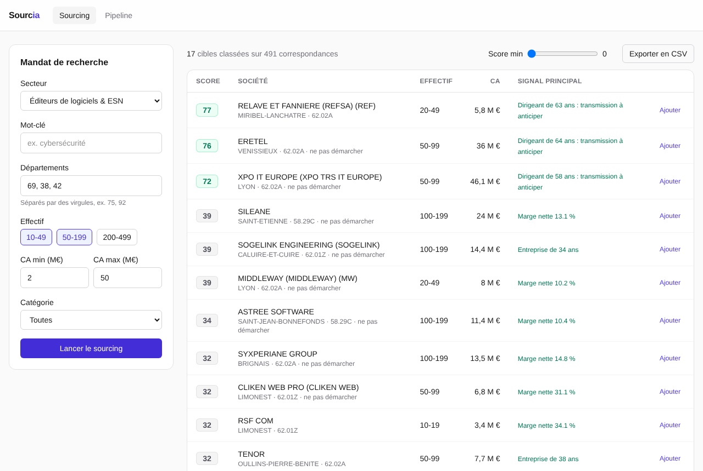
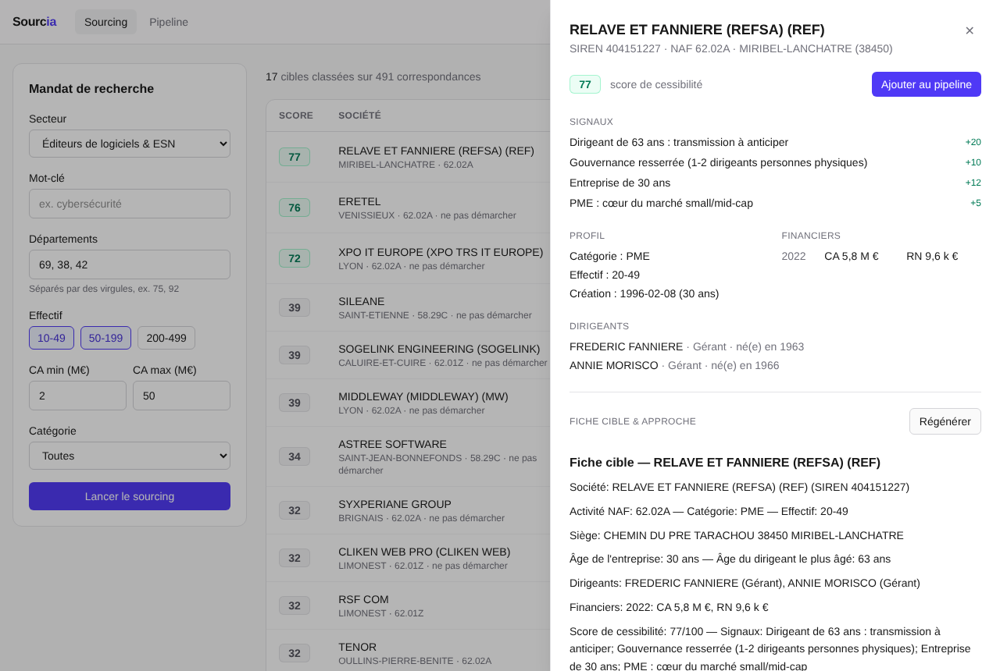

# Sourcia — sourcing M&A par IA

> Identifiez les PME françaises les plus susceptibles d'être cédées **avant** qu'elles ne soient sur le marché.
> Pour boutiques M&A, fonds small-cap et équipes corporate development.

    



## Le problème

Les meilleures opérations small/mid-cap se font **hors process** : le dirigeant n'a pas encore mandaté de banque d'affaires. Les trouver demande des heures de recherche manuelle dans les registres, sans savoir lesquelles sont réellement « cessibles ».

## Ce que fait Sourcia

1. **Mandat de recherche**: secteur (codes NAF prêts à l'emploi), départements, effectif, fourchette de CA, catégorie.
2. **Sourcing en direct** sur le registre national via l'[API Recherche d'entreprises](https://recherche-entreprises.api.gouv.fr) (gratuite, sans clé, plus de 30 millions d'entreprises).
3. **Score de cessibilité explicable (0-100)** : chaque point vient d'un signal visible.

| Signal | Effet |
| --- | --- |
| Dirigeant ≥ 65 ans (enjeu de succession) | +35 |
| Dirigeant 58-64 ans (transmission à anticiper) | +20 |
| Gouvernance resserrée, fondateur(s) aux commandes | +10 |
| Entreprise ≥ 25 ans / ≥ 12 ans | +12 / +7 |
| Marge nette ≥ 8 % | +12 |
| Croissance du CA ≥ 10 % | +8 |
| PME | +5 |
| Présidée par une holding ou un fonds | −15 |
| Pertes, CA en baisse, entreprise très récente | −6 à −10 |

4. **Fiche cible et email d'approche** générés par IA (Claude via Vercel AI Gateway) à partir des seules données publiques. Sans clé, un modèle déterministe prend le relais : l'app fonctionne toujours.
5. **Pipeline de deal flow** : À qualifier → À contacter → Contacté → Rendez-vous → NDA signé, avec des notes et un **export CSV** compatible Excel FR.



## Conformité

- Données publiques uniquement (INSEE Sirene, RNE).
- Les entreprises ayant fait **opposition à la prospection commerciale** sont signalées « ne pas démarcher ».
- L'email généré ne mentionne jamais l'âge du dirigeant.

## Démarrer

```bash
npm install
cp .env.example .env.local   # optionnel : AI_GATEWAY_API_KEY
npm run dev
```

http://localhost:3000, puis **Ouvrir l'application**.

```bash
npm test        # Vitest : scoring, mapping API, CSV, fallback
npm run build
```

## Architecture

```
src/
├── app/
│   ├── page.tsx               # landing
│   ├── app/page.tsx           # espace de sourcing
│   ├── app/pipeline/page.tsx  # pipeline kanban
│   └── api/
│       ├── search/route.ts    # validation zod → registre → scoring
│       └── brief/route.ts     # fiche cible IA (fallback modèle)
├── components/                # panneau société, UI
└── lib/
    ├── sirene.ts              # client API + mapping
    ├── scoring.ts             # moteur de score explicable
    ├── brief.ts               # fiche & email
    ├── pipeline.ts            # stockage du pipeline
    └── csv.ts                 # export
```

## Roadmap

- [x] Sourcing multi-critères sur le registre national
- [x] Score de cessibilité explicable
- [x] Fiche cible et email d'approche par IA
- [x] Pipeline et export CSV
- [ ] Comptes utilisateurs et pipeline partagé (Postgres)
- [ ] Veille : alertes quand une cible change de dirigeant ou publie ses comptes
- [ ] Signaux BODACC (cessions, procédures collectives)
- [ ] Recherche sémantique de comparables (« des sociétés comme X »)
- [ ] Synchronisation CRM (HubSpot, Pipedrive)

## Licence

MIT
